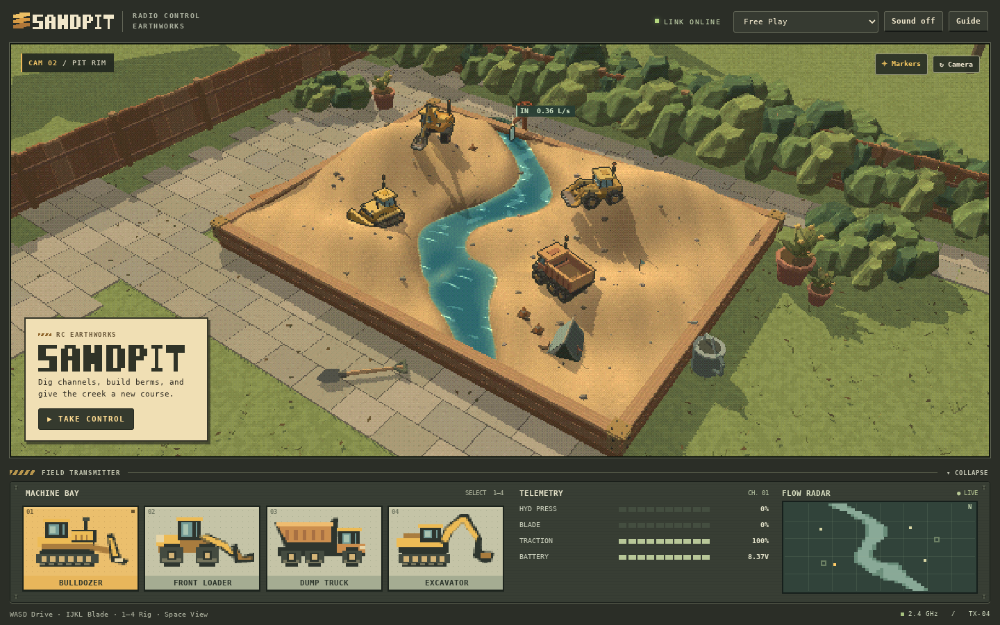

# Sandpit

[Play RC Earthworks](https://robvanprod.github.io/Sandpit/) · [Play RC Field Simulator](https://robvanprod.github.io/Sandpit/field/)

A pixel-art RC construction toy for the browser. Open **index.html** for Earthworks or **field/index.html** for the Field Simulator shown in the gameplay trailer. Each edition has its own controls in the game. Each game fits in one file and works offline. The hosted version can also use two Google Fonts.



## The field

Four machines share a 2.7 m × 2 m sandbox. The bulldozer moves a wedge of sand ahead of its blade. The loader and excavator hold real payloads. Raise a loaded bucket over the truck bed to transfer its contents, then drive the truck to the fill site and tip the bed.

- **Free Play** — adjust the spigot and rain in the field guide.
- **Divert the Creek** — cut wet channels, build a berm, fill both marked basins and protect the camp.
- **Coordinated Cut & Fill** — cut the spillway, load and drive the truck, then rebuild the leaking crest before the lower basin overflows.

## Controls

| Action | Keyboard and mouse | Standard gamepad | Touch |
|---|---|---|---|
| Drive and steer | WASD or arrows | Left stick, triggers for forward and reverse | Left stick |
| Lift and lower | I / K or vertical drag | Right stick vertically | Right stick vertically |
| Blade tilt, loader curl, excavator swing | J / L or horizontal drag | Right stick horizontally | Right stick horizontally |
| Dig or empty a bucket | Hold E or Q | Hold X or Y | Hold Scoop low to dig, raised to dump |
| Switch machine | 1–4, Tab, click a machine or bay card | LB / RB | Tap a machine, card or Rig |
| Change view | Space or Camera | A | Camera |
| Fine controls | F | Left stick click | Fine |
| Recover the active rig | R | B | Select the rig, then use the field guide |
| Frame the active rig at the pit rim | Scroll, or click the selected rig | Choose Chase for a close view | Tap the selected rig |

Right-drag to orbit in the pit-rim view. Sound starts muted. The transmitter can collapse to leave more room for the field.

## Simulation

Sand at rest lives in a heightfield. Cuts, sliding wet banks, tire shear, and tipped loads can turn part of that bed into volume-carrying 3D clumps. Each clump carries its sand, loam and gravel fractions. Gravity moves it between the cutting edge, the bed and the ground. Once supported and slow, it returns its volume to nearby cells. Suspended sediment in water has its own balance.

The ground has fixed native layers and a mixed layer of moved soil. Cutting through loose fill exposes a more cohesive loam bank, gravel lenses and eventually bedrock. Damp faces hold steeper cuts, loose grains roll downhill and saturated loam loses grip. Compacting a haul route changes how the next pass drives and how readily the next flow erodes it.

The Field Simulator tracks the truck load as a small heightfield attached to the bed. Its free surface slumps as the truck tips. Earthworks tracks a smaller cargo approximation with retained material composition and a movable load center. The field guide shows the material beneath the tool and the volume moving in clumps.

WebGL 2 draws the displaced surfaces, articulated machinery, shadow map and pixel outline pass. A software renderer shares the same field and vehicle models on browsers without WebGL 2. Canvas 2D draws the transmitter and world markers. Web Audio creates all sound.

## Verification

[Earthworks results](verification/results.json) · [Field Simulator results](verification/field-results.json) · [Vehicle and water captures](verification/polish.jpg) · [Earthworks browser suite](verification/check.py) · [Field Simulator browser suite](verification/field.cjs)

Material and grain regressions are in [material.cjs](verification/material.cjs), [field-grains.cjs](verification/field-grains.cjs) and [earthwork-grains.cjs](verification/earthwork-grains.cjs). They exercise layer exposure, mass transfer and settling using the game code.

The acceptance suite checks the final HTML directly with Chromium. It tests simultaneous touch inputs, Gamepad API mappings, both contracts, payload transfers, a natural levee breach and a seeded four-minute storm. Scenario fixtures stage machine positions. Digging, hydraulic transfers, water movement, truck travel and objective evaluation use the gameplay code.

To repeat the tests with Python and Playwright installed, run:

```sh
python -m playwright install chromium
python verification/check.py
```

An existing Chromium executable can be selected with `SANDPIT_CHROMIUM`. Set `SANDPIT_EVIDENCE` to direct captures and results to another directory. The suite uses a software WebGL implementation in headless mode. Physical handset frame rate and controller vibration require hardware checks.
